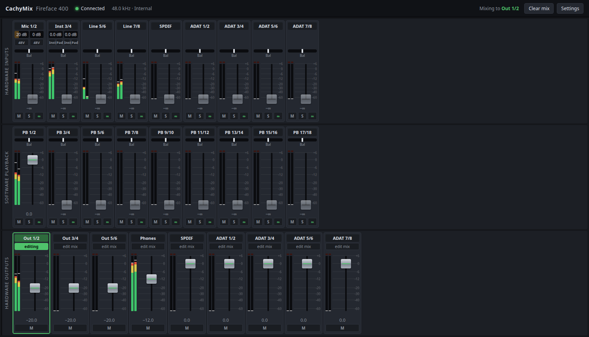

# CachyMix — a TotalMix-style mixer for the RME Fireface 400 on Linux

The RME Fireface 400 works fine on Linux for audio: the kernel driver
`snd-fireface` streams all 18 inputs and outputs. But RME's TotalMix only runs
on Windows and macOS, so on Linux you can't control the interface's hardware
mixer: no faders, no routing, no preamp gain, no phantom power, and the
front-panel knob does nothing.

CachyMix brings that back. It is a small desktop app (Tauri + React + Rust)
that talks to the Fireface directly over FireWire. You don't need FFADO or a
separate control daemon.



It was built on and for [CachyOS](https://cachyos.org) with KDE Plasma and
PipeWire, but it should work on any recent Linux distribution with the
`snd-fireface` kernel driver.

## Features

- **Hardware mixer, TotalMix style.** Three rows: hardware inputs, software
  playback and hardware outputs. Pick an output pair and mix every input and
  playback channel into it with fader, pan/balance, mute and solo. This is
  zero-latency monitoring, done inside the Fireface's own DSP.
- **Stereo link** per channel pair, or split a pair into two mono channels.
- **Output volumes** for Out 1–6, Phones, SPDIF and ADAT.
- **Preamps**: gain for Mic 1/2 (0–65 dB) and Inst 3/4 (0–18 dB), +48 V
  phantom power, Hi-Z instrument mode and pad.
- **Live level meters** for every input, playback channel and output, with
  peak hold and clip indicators.
- **Front-panel knob** works again: turning it changes the mic gains or output
  volumes, and the app follows along.
- **Settings**:
  - sample rate (32 / 44.1 / 48 kHz) and buffer size (32–2048 samples) via
    PipeWire, with the resulting latency shown;
  - clock source (internal, ADAT, SPDIF, word clock, LTC) with lock/sync
    status;
  - analog reference levels;
  - SPDIF/ADAT options.
- **Remembers everything.** The Fireface's mixer is write-only and can't
  report its state back, so CachyMix keeps the state itself and sends it to
  the device whenever it appears (power on, replug, resume).
- **Lives in the system tray** ("Status and Notifications" in KDE), like
  TotalMix on Windows. Click the icon to show or hide the window; right-click
  for the menu. Closing the window keeps it running. Optionally starts at
  login, hidden, and connects as soon as the Fireface is switched on.
- **Channel names**: double-click any channel or output name to rename it.

## Requirements

- Linux with the `snd-fireface` kernel module. It's in mainline; check with
  `lsmod | grep snd_fireface`.
- Your user in the `audio` group, so the app can open `/dev/fw*`.
  `ls -l /dev/fw*` should show group `audio` for the Fireface node.
- PipeWire, if you want to set sample rate and buffer size from the app
  (`pw-metadata` must be available).
- For the tray icon: a desktop with StatusNotifierItem support, such as KDE
  Plasma, or GNOME with the AppIndicator extension.

## Install

Download the AppImage from the
[releases page](https://github.com/BadgerSoft-NL/cachymix-rme-ff-400/releases),
make it executable and run it:

```bash
chmod +x CachyMix_*_amd64.AppImage
./CachyMix_*_amd64.AppImage
```

Then open **Settings → App → Start at login** if you want it to always be
there in the tray.

### Build from source

You need Rust, Node.js and the Tauri prerequisites for Linux
(`webkit2gtk-4.1`).

```bash
npm install
npm run tauri build -- --no-bundle      # → src-tauri/target/release/cachymix
npm run tauri build -- --bundles appimage
```

For development, `npm run tauri dev` runs the whole app. `npm run dev` runs
only the UI in a browser, against a simulated device.

## Good to know

- **First start resets the mixer.** The mixer can't be read back, so the first
  start sends a sensible default:
  - playback N goes to output N, and playback 1/2 also to Phones;
  - Out 1–6 at −20 dB and Phones at −12 dB;
  - phantom power off.

  After that, your own settings are restored every time.
- **Sample rate and buffer size belong to PipeWire.** CachyMix sets them with
  `pw-metadata`. It also writes
  `~/.config/pipewire/pipewire.conf.d/50-cachymix.conf` so they survive a
  restart; setting both back to *Auto* removes that file.
- **88.2 / 96 kHz is not supported yet.** At double speed the FF400 has 14
  channels instead of 18, and PipeWire's pro-audio profile assumes 18.
- State is stored in `toestand.json` in the app's folder under `~/.config/`.

## How it works

The Fireface 400 is controlled through asynchronous FireWire transactions to
a handful of registers. CachyMix sends them through the kernel's FireWire
character device (`/dev/fwN`, `linux/firewire-cdev.h`) and reads the
front-panel knob from the ALSA hwdep device that `snd-fireface` exposes. Audio
streaming stays with the kernel driver and PipeWire. CachyMix only ever
touches the mixer, so the two don't get in each other's way.

The register layout comes from the excellent reverse-engineering work in
[snd-firewire-ctl-services](https://github.com/alsa-project/snd-firewire-ctl-services)
by Takashi Sakamoto.

The source code (identifiers and comments) is in Dutch; everything you see
in the app is in English.

## License

[GPL-3.0-or-later](LICENSE). Free and open source.

CachyMix is an independent project and is not affiliated with or endorsed by
RME / Audio AG. "Fireface" and "TotalMix" are trademarks of their respective
owners.
